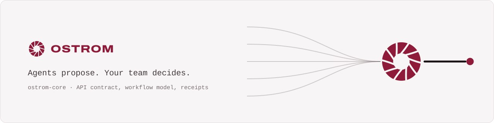
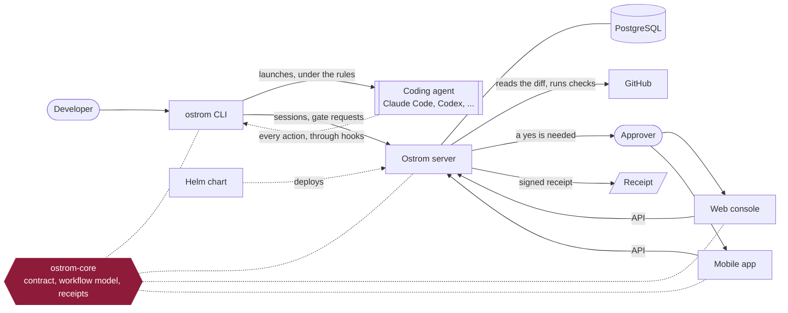

<p align="center">
  <a href="https://ostrom.run">
    <picture>
      <source media="(prefers-color-scheme: dark)" srcset=".github/assets/banner-dark.svg">
      
    </picture>
  </a>
</p>

<p align="center">
  <strong>Ostrom runs a company's AI coding agents in the cloud and makes them follow the team's rules.</strong><br>
  Every change they make leaves a receipt, and the few that matter wait for a person's yes.
</p>

<p align="center">
  <a href="https://ostrom.run">Website</a> ·
  <a href="https://ostrom.run/docs">Docs</a> ·
  <a href="https://github.com/ostrom-hq/ostrom-core/discussions">Discussions</a> ·
  <a href="CONTRIBUTING.md">Contributing</a> ·
  <a href="SECURITY.md">Security</a>
</p>

<p align="center">
  <a href="https://github.com/ostrom-hq/ostrom-core/actions/workflows/build.yml"></a>
  <a href="LICENSE"></a>
  
</p>

## What this is

The Kotlin Multiplatform library shared by the Ostrom CLI, server and companion app: the protocol models, the signed
receipts, the API contract and its typed client. Targets: `macosArm64`, `linuxX64`, `linuxArm64`, `mingwX64`
(Kotlin/Native only, no JVM); `api` and `client` also target Android and iOS for the companion app. Apache 2.0.

| Module | Artifact | Contents |
|---|---|---|
| `api` | `run.ostrom:ostrom-api` | serializable models (`run.ostrom.core.api.models`): organization, member, team, dev, rule, session and its segments, gate request, approval (yes bound to repository, SHA and commits), answer, decision, check run, notification, receipt, session package (hooks, scripts, notifications, nodes, MCP, files), workflow (nodes trigger, step, check, gate, notify, agent, wait, workflow), workflow run and visits, automation, wait; and `OstromJson`, the shared JSON configuration |
| `client` | `run.ostrom:ostrom-client` | the typed Ktor client of the server API (`run.ostrom.core.client.OstromClient`): the caller's engine and token provider, `OstromException` from the contract's `ApiError`, a bounded event-stream reader, PKCE; also for Android and iOS ([docs/client.md](docs/client.md)) |
| `receipts` | `run.ostrom:ostrom-receipts` | canonical JSON v1, SHA-256 digests, Ed25519 signing and offline verification of receipts and session packages, subject preimages |
| `telemetry` | `run.ostrom:ostrom-telemetry` | W3C trace context, spans, metrics and logs exported as OTLP/HTTP protobuf (Grafana Cloud, any collector), model-call spans for Langfuse, PostHog product events and their taxonomy ([docs/telemetry.md](docs/telemetry.md)); also published for the JVM, so a consumer's JVM coverage tests can use it |
| `api/openapi.yaml` | `@ostrom-hq/api-types` (npm) | the OpenAPI 3.1 contract of every server route; TypeScript types generated by openapi-typescript |

Receipts and packages are byte-compatible with the TypeScript prototype: the tests replay its golden vectors
(`compat/`, see its README).

## Quick start

```sh
git clone https://github.com/ostrom-hq/ostrom-core.git && cd ostrom-core
./gradlew linuxX64Test     # on a Mac: ./gradlew macosArm64Test
```

## How it fits



## Status

Ostrom is before its first public release.

| Part | Status |
| --- | --- |
| Protocol models, signed receipts, session packages | Available, byte-compatible with the prototype's golden vectors |
| OpenAPI contract of the server routes | Available; ahead of the server, which does not serve every route yet |
| Artifacts (`run.ostrom:ostrom-*`, `@ostrom-hq/api-types`) | GitHub Packages of the organization, `0.1.<run number>` on every merge |
| Maven Central (`run.ostrom:ostrom-*`) | Major releases only, published by hand ([docs/publishing.md](docs/publishing.md)) |

## Use it from another repository

Every merge on `main` publishes `0.1.<run number>` to GitHub Packages (the run number is in the summary of the
Actions run). GitHub Packages needs a token with `read:packages`, even for reading:

```kotlin
// settings.gradle.kts
dependencyResolutionManagement {
    repositories {
        mavenCentral()
        maven {
            url = uri("https://maven.pkg.github.com/ostrom-hq/ostrom-core")
            credentials {
                username = providers.gradleProperty("gpr.user").orElse(providers.environmentVariable("GITHUB_ACTOR")).get()
                password = providers.gradleProperty("gpr.key").orElse(providers.environmentVariable("GITHUB_TOKEN")).get()
            }
        }
    }
}

// build.gradle.kts
kotlin {
    sourceSets.commonMain.dependencies {
        implementation("run.ostrom:ostrom-receipts:0.1.<run>") // brings ostrom-api
    }
}
```

In GitHub Actions of another `ostrom-hq` repository, `GITHUB_TOKEN` reads the package once the repository is granted
access in the package settings (Package settings → Manage Actions access).

To work on core and a consumer together, without publishing, in the consumer's `settings.gradle.kts`:

```kotlin
includeBuild("../ostrom-core") {
    // the published artifact ids carry an ostrom- prefix the project names do not have
    dependencySubstitution {
        substitute(module("run.ostrom:ostrom-api")).using(project(":api"))
        substitute(module("run.ostrom:ostrom-receipts")).using(project(":receipts"))
    }
}
```

## The API contract

`api/openapi.yaml` is the contract of the server routes (`/api/v1/...`), written by hand. Each schema has a Kotlin
model with the same JSON shape, except those marked `x-ostrom-kotlin: pending`: `ContractTest` (api module) compares
the serial descriptors of the models with `api/contract/shapes.json`, and CI checks that this file is the one
`api-types/scripts/contract-shapes.mjs` derives from `openapi.yaml`. To change the contract: edit `openapi.yaml`, run
`npm run contract` in `api-types/`, change the Kotlin model, commit the three.

The contract is ahead of the server: it also describes routes the server does not serve yet. Every operation carries
`x-ostrom-status`: `served` when ostrom-server's `main` answers it, `planned` otherwise (`npm run contract` refuses an
operation without it). The public [API reference](https://ostrom.run/docs/reference/api) lists the `served` ones.
`api/contract/served-routes.txt` lists the routes `main` serves, read from the server's sources by
`scripts/served-routes.py`, and `npm run contract` fails when a marker disagrees with it. When a server PR lands that
serves (or stops serving) a route, regenerate the list against that `main` and flip the marker in the same PR:

    python3 scripts/served-routes.py ../ostrom-server   # then keep the file's header and `!` lines

A `!` line keeps `planned` a route `main` serves in another shape than the contract's; the operation's description
says what `main` serves instead.

TypeScript: `@ostrom-hq/api-types`, published to GitHub Packages npm with the same `0.1.<run>` version as the Kotlin
artifacts. `.npmrc`:

```
@ostrom-hq:registry=https://npm.pkg.github.com
//npm.pkg.github.com/:_authToken=${GITHUB_TOKEN}
```

```ts
import type { components, paths } from '@ostrom-hq/api-types'
type Receipt = components['schemas']['Receipt']
```

## Receipts in three calls

```kotlin
val key = ReceiptSigningKey.fromPkcs8Pem(pem)                  // or fromSeed, generate
val receipt = ReceiptSignerImpl(key).sign(draft)               // ReceiptDraft -> Receipt, signature field added
val result = ReceiptVerifierImpl(listOf(key.publicKey)).verify(json) // the raw JSON object as received, never the typed model
```

Subject digests: `Digests.digestOf(SubjectPreimages.session(...))` (also `gate`, `workflow`, `ruleChange`,
`decision`, and `pushActionKey` for the key of a push gate request).

Session packages: `PackageEnvelopes.verify(envelope, keys)` returns the verified payload text; only the payload is signed,
so read the repository and version from the decoded payload, never from the envelope fields.

## Build and test

On every pull request and on `main`, `.github/workflows/build.yml` runs two jobs on Linux. `native`:

```sh
./gradlew --no-daemon linuxX64Test compileTestKotlinLinuxArm64 compileTestKotlinMingwX64 compileKotlinMacosArm64
```

`contract`, in `api-types/`:

```sh
npm ci --no-audit --no-fund
npm run contract
git diff --exit-code -- ../api/contract/shapes.json
npm run build
```

`macosArm64Test` and `mingwX64Test` run only when the workflow is started by hand with `full_validation`. Locally:
`./gradlew linuxX64Test` on Linux, `./gradlew macosArm64Test` on a Mac.

## Documentation

- [Receipt format v1](https://ostrom.run/docs/receipts/format): the open specification these modules implement.
- [`docs/CONVENTIONS.md`](docs/CONVENTIONS.md): the engineering conventions of every Ostrom repository.
- [`compat/README.md`](compat/README.md): the golden vectors and the byte-level rules they freeze.

## Repositories

| Repository | What it is | License |
| --- | --- | --- |
| **ostrom-core** (this one) | Shared Kotlin Multiplatform library: API contract, workflow model, signed receipts | Apache-2.0 |
| [ostrom-cli](https://github.com/ostrom-hq/ostrom-cli) | The `ostrom` command line: runs coding agents under the team's rules | Apache-2.0 |
| [ostrom-server](https://github.com/ostrom-hq/ostrom-server) | The server: gates, receipts, policies, the API | AGPL-3.0 + ee |
| [ostrom-web](https://github.com/ostrom-hq/ostrom-web) | The web console | AGPL-3.0 + ee |
| [ostrom-app](https://github.com/ostrom-hq/ostrom-app) | The iOS and Android app | AGPL-3.0 + ee |
| [ostrom-e2e](https://github.com/ostrom-hq/ostrom-e2e) | Full-stack end-to-end and load tests | Apache-2.0 |
| [ostrom-site](https://github.com/ostrom-hq/ostrom-site) | ostrom.run: website, documentation, blog | Apache-2.0 |
| [ostrom-helm](https://github.com/ostrom-hq/ostrom-helm) | Helm chart and Docker Compose for self-hosting | AGPL-3.0 |

## Contributing

Contributions are welcome. Read [CONTRIBUTING.md](CONTRIBUTING.md) (setup, tests, Conventional Commits, DCO), the
[Code of Conduct](CODE_OF_CONDUCT.md), and [SECURITY.md](SECURITY.md) to report a vulnerability privately. Questions
go to [Discussions](https://github.com/ostrom-hq/ostrom-core/discussions); help options are in [SUPPORT.md](SUPPORT.md).

## License

Apache License 2.0, see [LICENSE](LICENSE) and [NOTICE](NOTICE). You can use it in any project, open source or not.
