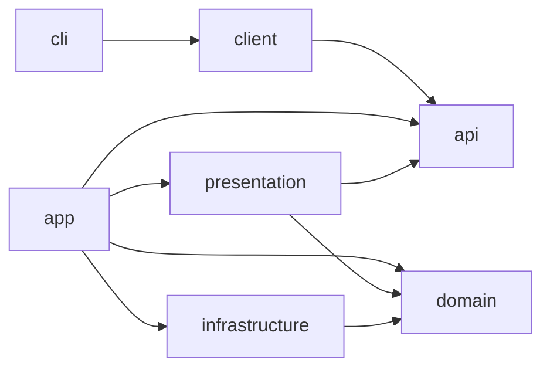

# Ostrom engineering conventions

These conventions apply to every Ostrom repository: `ostrom-core`, `ostrom-cli`, `ostrom-server`, `ostrom-web`
and `ostrom-app`. They are Nathan Fallet's practices, read in his most recent code, adapted to a product that is
**Kotlin/Native only** (no JVM in production) with a React/TypeScript web app and a React Native (Expo) mobile app.

Read this file before every pull request: it grows. Each rule cites where it comes from. Sources, all read on
30/10/2026:

| Short name | Repository | Why it matters |
| --- | --- | --- |
| `teamcode` | `nathanfallet/teamcode` (Kotlin 2.4.20, Ktor 3.6, native CLI on four targets) | His most recent and largest codebase; the CLI is Kotlin/Native |
| `asonar` | `nathanfallet/asonar` (Kotlin 2.4.20, KMP Clean Architecture) | The module layout and naming every recent project follows |
| `pkg` | `nathanfallet/pkg` (Kotlin 2.4.20, Zodable, convention plugin) | Kotlin contract to TypeScript, included Gradle build |
| `worker-tutorial` | `nathanfallet/ktor-native-worker-tutorial` | Ktor server on Kotlin/Native (CIO), Koin, `expect`/`actual` |
| `bench` | `nathanfallet/kotlin-bench-native-vs-jvm` | His measurements of where Kotlin/Native is slow |
| `flareon` | `nathanfallet/flareon` | `cryptography-kotlin` with OpenSSL on native, detekt |
| `kaccelero` | `nathanfallet/kaccelero` | His older KMP framework (`I`-prefixed interfaces: superseded, see below) |
| `cr-backend`, `cr-app` | ControlResell backend and app | The same practices applied in production; the `kotlin-bp` and `react-bp` review checklists |
| `ENG-0xx`, `INF-0xx` | ControlResell engineering rules | Rules Nathan set after real incidents; only the generic ones are reused here |

Templates ready to copy are in [`docs/conventions/`](conventions/). Repository text, code, comments, commits and
pull requests are in **English** (`teamcode:AGENTS.md`).

Contents: [1 Architecture](#1-architecture) · [2 Kotlin code](#2-kotlin-code) ·
[3 Errors](#3-errors) · [4 Coroutines](#4-coroutines) · [5 Serialization and contracts](#5-serialization-and-contracts) ·
[6 Logs and configuration](#6-logs-and-configuration) · [7 Tests](#7-tests) · [8 Lint and style](#8-lint-and-style) ·
[9 Gradle](#9-gradle) · [10 Kotlin/Native](#10-kotlinnative) · [11 CI](#11-ci) ·
[12 Versions, releases, publication](#12-versions-releases-publication) · [13 TypeScript](#13-typescript) ·
[14 Git and pull requests](#14-git-and-pull-requests) · [15 What Nathan does not do](#15-what-nathan-does-not-do) ·
[16 Multi-tenancy, security and performance budgets](#16-multi-tenancy-security-and-performance-budgets)

---

## 1. Architecture

### 1.1 Modules and the dependency graph

Every Kotlin repository is a Gradle multi-module build with the module roles of `asonar` and `teamcode`. Root
package and Gradle group: `dev.ostrom`; a module's package is `dev.ostrom.<repo>.<module>`
(`dev.ostrom.server.domain`, `dev.ostrom.cli`), as `me.nathanfallet.teamcode.<module>` in `teamcode`.

| Module | Repository | Responsibility | Depends on |
| --- | --- | --- | --- |
| `api` | core | `@Serializable` DTOs, typed Ktor `@Resource` routes, `ApiError`, events. The contract. | nothing of ours |
| `client` | core | Typed HTTP client over `api`; the caller supplies the engine and the credentials | `api` |
| `receipts`, `workflow`, … | core | Protocol code shared by CLI and server (canonical JSON, signed receipts, workflow model) | `api` at most |
| `domain` | server | Models, use cases, repository and service **interfaces** | core protocol modules, never `api` |
| `infrastructure` | server | Database, HTTP adapters, crypto, filesystem: implementations of the domain interfaces | `domain` |
| `presentation` | server | Ktor routes, mappers domain → `api`, StatusPages | `domain`, `api` |
| `app` | server | Composition root: configuration, Koin modules, `main`, lifecycle | everything |
| `cli` | cli | Native commands, local loopback server, processes, PTY, OS credentials | core `client`, `api`, protocol modules |

The graph from `teamcode:docs/architecture.md`:



- `domain` and `api` depend on no other project module. Infrastructure never imports a public DTO; presentation maps
  domain objects to contracts (`teamcode:docs/architecture.md`).
- The CLI never depends on server `domain` or `infrastructure` (`teamcode:AGENTS.md`).
- The graph is **enforced in CI** by a script, as `teamcode:scripts/check-module-graph.py` does: copy
  [`check-conventions.py`](conventions/scripts/check-conventions.py) and list your modules in it.

### 1.2 Naming: `XXX` interface, `XXXImpl` implementation

Interfaces carry the plain name, implementations the `Impl` suffix. Never `IXXX` (that is `kaccelero`'s older style,
explicitly superseded in `kotlin-bp`). An implementation tied to a technology may name it instead of `Impl`
(`PostgresGatesRepository`, `ClaudeTransport` in `teamcode`) when several exist side by side.

```kotlin
// asonar: domain/usecases/apps/GetAppUseCase.kt + GetAppUseCaseImpl.kt
/** Reads one app by its identifier. */
interface GetAppUseCase {
    suspend operator fun invoke(id: Long): App?
}

class GetAppUseCaseImpl(
    private val appsRepository: AppsRepository,
) : GetAppUseCase {
    override suspend fun invoke(id: Long): App? = appsRepository.get(id)
}
```

One interface per file, its `Impl` in the next file, grouped by feature folder: `usecases/gates/`,
`repositories/`, `services/` (`asonar:domain/src/commonMain/.../usecases/apps/`).

### 1.3 Use cases hold the business rules

- One use case = one action, `suspend operator fun invoke(...)`, constructor injection of its repositories and
  services (`asonar:DeleteAppUseCaseImpl.kt`).
- **Business rules live in use cases and services, never in HTTP routes or CLI commands** (`teamcode:AGENTS.md`).
  A route parses, calls one use case, maps the result. A CLI command parses arguments, calls the client or a use case,
  prints.
- A use case that can refuse returns the reason, not `null` that a route turns into a 500 (`ENG-007`): a sealed
  result or a domain exception (section 3).

### 1.4 Repositories are interfaces in the domain

```kotlin
// asonar: domain/repositories/AppsRepository.kt
/** Reads and writes the apps we optimize. */
interface AppsRepository {
    /** Lists every tracked app, newest first. */
    suspend fun list(): List<App>
    /** Reads an app by its identifier. */
    suspend fun get(id: Long): App?
    /** Removes an app. @return True if a row was deleted. */
    suspend fun delete(id: Long): Boolean
}
```

- Methods are `suspend`, return domain models, and take payload classes (`AppPayload`) for writes.
- Database types (rows, statements, drivers) never leave `infrastructure` (`teamcode:docs/architecture.md`).
- **No N+1**: never call a repository per row of a list. Add a batch method that reads everything in one transaction.
  Every list query is bounded (`LIMIT`), paginated by keyset, never `OFFSET`; no `COUNT(*)` where `EXISTS` is enough;
  no transaction held across a network call (`teamcode:AGENTS.md`).

### 1.5 Dependency injection: Koin in the composition root

- Koin modules per layer, `val domainModule = module { ... }`, binding interfaces to implementations
  (`asonar:domain/di/DomainModule.kt`):

```kotlin
val domainModule: Module = module {
    single<ListGatesUseCase> { ListGatesUseCaseImpl(get()) }
    single<AnswerGateUseCase> { AnswerGateUseCaseImpl(get(), get(), get()) }
}
```

- Koin is wired **only in `app`** (server) and in the CLI entry point. Use cases and repositories never call
  `get()`/`inject()` themselves: constructor injection only.
- Routes receive their use cases through a `XxxRoutesDependencies` data class resolved once at startup
  (section 1.6). **No `koin-ktor` plugin** (`install(Koin)`): it opens a Koin scope per call that a cancelled call
  (SSE, WebSocket, streamed run) never closes, which leaked calls in ControlResell (`INF-074`). `app` builds the Koin
  application itself and hands each route its dependencies:

```kotlin
// app: composition root
fun main() {
    val koin = koinApplication { modules(configModule(ServerConfig.fromEnvironment()), domainModule,
        infrastructureModule, presentationModule) }.koin
    embeddedServer(CIO, port = koin.get<ServerConfig>().port) { module(koin) }.start(wait = true)
}

fun Application.module(koin: Koin) {
    configureSerialization()
    configureErrorHandling()
    routing { gatesRoutes(koin.get<GatesRoutesDependencies>()) }
}
```

### 1.6 Ktor routes: typed resources and a dependencies data class

Nathan's current pattern is `asonar`'s and `teamcode`'s: typed `@Resource` classes in `api` (shared with the client),
a `Route.xxxRoutes(dependencies)` extension per feature. Not `kaccelero`'s generic `IModelRouter`/controllers: no
recent project of his uses them.

```kotlin
// api (ostrom-core): asonar:api/resources/apps/AppsResources.kt
@Serializable
@Resource("/api/v1/gates")
class GatesApi {
    @Serializable
    @Resource("{id}")
    class Id(val parent: GatesApi = GatesApi(), val id: Uuid)
}

// presentation (ostrom-server): asonar:presentation/routes/apps/AppsRoutes.kt
data class GatesRoutesDependencies(
    val listGatesUseCase: ListGatesUseCase,
    val getGateUseCase: GetGateUseCase,
)

fun Route.gatesRoutes(dependencies: GatesRoutesDependencies) = with(dependencies) {
    get<GatesApi> {
        call.respond(listGatesUseCase(call.principal()).map { it.toGateResponse() })
    }
    get<GatesApi.Id> { params ->
        // Absent or not the caller's: GateNotFoundException, mapped to 404 by StatusPages (section 3).
        call.respond(getGateUseCase(call.principal(), params.id).toGateResponse())
    }
}
```

- Version the management API under `/api/v1` (`teamcode:docs/architecture.md`).
- Mappers are extension functions in `presentation/mappers/<feature>/`: `Gate.toGateResponse()`
  (`asonar:presentation/mappers/`).
- **Every route declares who may call it, and a test proves it**: without a token → 401 (except the unauthenticated routes listed in `ostrom-server`'s `docs/security.md`,
  section 16.2, each tested as such); another organization's resource → 404,
  exactly like an unknown id; a list returns only the caller's rows (`ENG-054`). Identity comes from the credential,
  never from a caller-controlled header (`teamcode:docs/architecture.md`).

### 1.7 `expect`/`actual` at the platform boundary only

Platform code (environment, files, processes, PTY, keychain, signals) sits behind a small `expect` declaration in
`commonMain` with one `actual` per platform family (`worker-tutorial:Env.kt`, `teamcode:cli/src/posixMain`).
Share POSIX code between macOS and Linux through a `posixMain` source directory added to both
(`teamcode:cli/build.gradle.kts`):

```kotlin
sourceSets {
    macosMain.get().kotlin.srcDir("src/posixMain/kotlin")
    linuxMain.get().kotlin.srcDir("src/posixMain/kotlin")
}
```

Keep native files thin: the logic stays in `commonMain`, where it is unit-tested and measured (section 7).

---

## 2. Kotlin code

- `kotlin.code.style=official` in `gradle.properties` (every Nathan repository).
- `data class` for models, payloads, DTOs; `val` over `var`; `sealed` interfaces or classes for closed hierarchies;
  extension functions for mapping (`kotlin-bp`).
- **KDoc on every public declaration**, saying *why*, not paraphrasing the code (`asonar`, `kotlin-bp`):

```kotlin
/**
 * Answers a gate for one approver. The first "yes" closes the other approvers' requests in the same transaction,
 * so two approvers can never both open the gate.
 *
 * @param principal The authenticated approver; never the requester, unless they are the only declared approver.
 * @return The gate as it is after the answer.
 * @throws GateNotFoundException When the gate does not exist or belongs to another organization.
 */
suspend operator fun invoke(principal: Principal, gateId: Uuid, answer: GateAnswer): Gate
```

- Comments explain a non-obvious decision and its reason; Nathan's comments often cite the measured fact or the
  incident (`teamcode:cli/src/nativeInterop/cinterop/tls_exit.def`). No `TODO:`/`FIXME:` in merged code (detekt
  `ForbiddenComment`).
- Null safety: no `!!` in production code; `requireNotNull`/`checkNotNull` with a message, `?:` with an explicit
  refusal, `as?` (`kotlin-bp`).
- Identifiers: `kotlin.uuid.Uuid`; time: `kotlin.time.Instant` and an **injected** `kotlin.time.Clock` (never
  `Clock.System` inside a use case: tests must control time). Opt in once in the convention plugin
  (`kotlin.uuid.ExperimentalUuidApi`, `kotlin.time.ExperimentalTime`, as `asonar` and `pkg` do).
- Bound everything that comes from outside: request bodies, queues, retries, network waits (`teamcode:AGENTS.md`).

---

## 3. Errors

### 3.1 Domain exceptions, mapped once

A refusal the code expects is a **domain exception** (one class per case, in `domain/models/exceptions/`) or a sealed
result; presentation maps it to a status in one StatusPages configuration. Never `return@get call.respond(...)`
scattered in routes with free-text bodies (that is `asonar`'s shortcut, which `kotlin-bp` explicitly overrides).

**On Kotlin/Native, StatusPages matches a handler by the exact exception class only** (found by `ostrom-server`,
30/10/2026: every domain error, being a subclass, answered 500). So domain exceptions extend one base that carries its
`ErrorKind` (the stable key of section 3.3), presentation maps each kind to its status once, and the single `Throwable`
handler routes by type:

```kotlin
// domain of the shared kernel: no Ktor type here
enum class ErrorKind(val code: String) {
    INVALID_REQUEST("invalid_request"), UNAUTHENTICATED("unauthenticated"), FORBIDDEN("forbidden"),
    NOT_FOUND("not_found"), CONFLICT("conflict"), PAYMENT_REQUIRED("payment_required"), INTERNAL("internal_error"),
}

open class OstromException(val kind: ErrorKind, message: String) : Exception(message)

// domain
class GateNotFoundException : OstromException(ErrorKind.NOT_FOUND, "Gate not found.")
class GateAlreadyAnsweredException : OstromException(ErrorKind.CONFLICT, "The gate is already answered.")

// presentation/config/ErrorHandling.kt: the only place a kind becomes a status (section 3.2)
fun ErrorKind.status(): HttpStatusCode = when (this) {
    ErrorKind.INVALID_REQUEST -> HttpStatusCode.BadRequest
    ErrorKind.UNAUTHENTICATED -> HttpStatusCode.Unauthorized
    ErrorKind.FORBIDDEN -> HttpStatusCode.Forbidden
    ErrorKind.NOT_FOUND -> HttpStatusCode.NotFound
    ErrorKind.CONFLICT -> HttpStatusCode.Conflict
    ErrorKind.PAYMENT_REQUIRED -> HttpStatusCode.PaymentRequired
    ErrorKind.INTERNAL -> HttpStatusCode.InternalServerError
}

fun Application.configureErrorHandling(logger: Logger) {
    install(StatusPages) {
        exception<Throwable> { call, cause ->
            when (cause) {
                // A cancelled call (client gone, server stopping) is not a defect: let it propagate (section 4.1).
                is CancellationException -> throw cause
                is OstromException -> call.respondError(cause.kind, cause.message ?: cause.kind.code)
                is BadRequestException -> call.respondError(ErrorKind.INVALID_REQUEST, "The request is malformed.")
                else -> {
                    // Unexpected only. Log the type and the request id, never the request or response body.
                    logger.error("unexpected failure", mapOf("request_id" to call.callId), cause)
                    call.respondError(ErrorKind.INTERNAL, "Internal error.")
                }
            }
        }
    }
}
```

A test throws a **subclass** of the base and asserts its status and key (`ostrom-server:HttpTest.
domainErrorSubclassKeepsItsKindAndMessage`), and another throws an unexpected exception and asserts a 500 that does not
echo its message.

### 3.2 The status names the refusal (`ENG-007`)

| Refusal | Status |
| --- | --- |
| Object absent, or not the caller's | `404` |
| State does not allow the action | `409` + key |
| Malformed request (deserialization included) | `400` |
| Not authenticated / credential revoked | `401` |
| Authenticated but not allowed | `403` (or `404` when existence must not leak) |
| Quota or plan limit | `402` |

`500` means "the server has a defect" and is reserved for what the code did not foresee.

### 3.3 One error body, owned by the contract

The error body is a `@Serializable` type in `api` (`teamcode:api/models/Status.kt`):
`ApiError(error = ErrorDetail(type = "gate_not_found", message = "..."))`. `type` is a stable `snake_case` key the
clients switch on; once published it never changes (section 5). The `message` is for humans and never contains a
secret, a prompt, a token or a raw upstream body (`teamcode:AGENTS.md`). Never echo `cause.message` of an unexpected
exception to the client.

### 3.4 CLI errors

A CLI command maps known failures to a one-line message on stderr and a documented exit code; a stack trace only
under `--debug`. Errors that the user can fix say how (`teamcode:cli/CliErrors.kt`).

---

## 4. Coroutines

### 4.1 Never swallow `CancellationException` — blocking in review

Rule `INF-019` and `kotlin-bp`. Any broad catch (`Exception`, `Throwable`, `_` of a broad type) reachable from a
coroutine rethrows `CancellationException` **first**:

```kotlin
// teamcode: app/src/main/kotlin/.../Application.kt
try {
    withTimeout(maintenanceDeadline) { maintenance.run() }
} catch (_: TimeoutCancellationException) {
    // Our own timeout: a failure of this step, not a cancellation of the caller.
    log.warn("Maintenance deadline exceeded.")
} catch (error: CancellationException) {
    throw error
} catch (error: Exception) {
    log.error("Maintenance failed: ${error::class.simpleName}", error)
}
```

- **No `runCatching` around suspend code** — it catches `CancellationException`. Write the `try`/`catch` inline at
  every site; no helper such as `suspendRunCatching` (`kotlin-bp`: the guard must be visible and greppable).
  `runCatching` stays acceptable in code no coroutine can reach (`teamcode:cli/daemon/Folders.kt`,
  `FileSystem.canonicalize`), with a comment saying so.
- Your own `withTimeout`: catch `TimeoutCancellationException` **before** the `CancellationException` clause, or use
  `withTimeoutOrNull` (`teamcode:Application.kt`).
- Someone else's cancellation (writing to a dead SSE or WebSocket call): contain it with
  `currentCoroutineContext().ensureActive()` in the catch, so only *our* cancellation propagates (`kotlin-bp`).
- `RuntimeException`, `IllegalStateException` and `Error` count as broad: `CancellationException` is an
  `IllegalStateException`. A narrow catch (`IOException`, `ClientRequestException`) needs nothing extra.
- Outside coroutines (parsing a payload, reading a config file), catch the narrow type (`SerializationException`,
  `IllegalArgumentException`, `IOException`) rather than `Exception`.
- CI enforces this lexically with [`check-conventions.py`](conventions/scripts/check-conventions.py): a broad catch with
  no `CancellationException` rethrow before it (or `ensureActive()` in it) and every `runCatching` fail the build. Code
  no coroutine can reach says so on the line or the line above: `// not coroutine-reachable: <reason>`, reviewed.
- **Test it**: each use case with a broad catch has a test where the collaborator throws `CancellationException` and the
  test asserts it comes out (`invokeWithCancellationPropagatesException`).

### 4.2 Cleanup survives cancellation

Cleanup that must run when the caller is cancelled (kill a child process, close a session, release a lease) runs in
`finally { withContext(NonCancellable) { ... } }` (`teamcode:cli/src/posixMain/.../platform/Process.kt`).

### 4.3 Structured concurrency

- No `GlobalScope`. Long-lived work belongs to a scope owned by the application (`Application` is a
  `CoroutineScope` in Ktor; the CLI daemon owns its scope) and is cancelled on shutdown.
- Inject dispatchers (`InjectDispatcher` in detekt): a blocking native call (`libpq`, `waitpid`, file IO through POSIX)
  runs on `Dispatchers.IO` or a `limitedParallelism` view passed by constructor, never on the request dispatcher.
- Never replay a stream after output was committed; bound queues and retries (`teamcode:AGENTS.md`).

---

## 5. Serialization and contracts

- `kotlinx.serialization` everywhere; one shared `Json` instance per repository, configured once
  (`worker-tutorial:Serialization.kt`, `teamcode:api/Serialization.kt`), injected or referenced — never a
  `Json { }` built per call.
- **`ostrom-core` owns the contract** (`ENG-001`): DTOs, resources, error keys, events. A consumer (server, CLI, web,
  app) never redeclares a `@Serializable` contract or a hand-built request body; it depends on the published package.
  TypeScript types are **generated** from it (section 13.4).
- **Every subclass of a `@Serializable` sealed hierarchy has an explicit, stable `@SerialName`** — blocking in review
  (`kotlin-bp`). Without it the discriminator is the fully qualified class name: moving the class changes the JSON.
- **Evolve without breaking the other side** (`ENG-009`): add a field only as optional (`val x: T? = null`); remove a
  field only once it is optional on both sides and every deployed client has that version; rename = add new + remove
  old with that protocol. A shared enum has an `UNKNOWN` fallback when clients may lag.
- Byte-exact formats (canonical JSON, receipts, packages) are covered by **golden vectors** checked into the repository
  (`ostrom-core/compat/`), read by tests on every target. A change that alters one byte of a golden output is a protocol
  version change, never a refactor.

---

## 6. Logs and configuration

### 6.1 Logs

- Server: Ktor's logger (`call.application.log`, `KtorSimpleLogger("dev.ostrom.server.X")`), which works on
  Kotlin/Native (`teamcode` uses `io.ktor.util.logging`). No SLF4J/Logback: they are JVM-only.
- CLI: human output on stdout, diagnostics on stderr, never both mixed in a machine-readable output (`--json`).
- **Never log credentials, tokens, prompts, response bodies, or raw provider errors** (`teamcode:AGENTS.md`). Identifiers
  (organization, user, run) are not metric labels.
- A guard that refuses or skips is **counted** (a counter with a bounded `reason` attribute) rather than logged at each
  hit (`ENG-003`), once metrics exist; until then one `debug` line, never an `info` per request.

### 6.2 Configuration

- Read the environment once, in the composition root, into a typed configuration object; everything else receives
  values by constructor (`worker-tutorial:di/MainModule.kt`):

```kotlin
// worker-tutorial: Env.kt (expect) + Env.native.kt (actual, platform.posix.getenv)
expect fun getEnv(name: String): String?

// The serving process reads OSTROM_DATABASE_URL (runtime role) and never the migration URL; `ostrom-server migrate`
// has its own MigrationConfig that reads only OSTROM_DATABASE_MIGRATION_URL (section 16.1).
data class ServerConfig(val port: Int, val databaseUrl: String, val publicUrl: String) {
    companion object {
        fun fromEnvironment(): ServerConfig = ServerConfig(
            port = getEnv("OSTROM_PORT")?.toIntOrNull() ?: 8080,
            databaseUrl = requireNotNull(getEnv("OSTROM_DATABASE_URL")) { "OSTROM_DATABASE_URL is required." },
            publicUrl = requireNotNull(getEnv("OSTROM_PUBLIC_URL")) { "OSTROM_PUBLIC_URL is required." },
        )
    }
}
```

- Variables are prefixed `OSTROM_`. A missing required value fails at startup with a clear message, never later.
- **No business behaviour behind a configuration switch** (`ENG-050`): a variable configures infrastructure (port,
  URLs, pool size), it never turns a product feature on or off. The `ee/` features are enabled by the license key, by
  code, not by an environment flag.
- Secrets come from the environment or a file path given in the environment; never from the repository, never logged,
  never in CI in clear (`BRIEF`).

---

## 7. Tests

### 7.1 What must exist (Lyes, 30/10/2026: "everything from A to Z, day one")

- **Unit tests** of all added code, **integration tests** (real PostgreSQL in CI, real HTTP), **end-to-end tests** of the
  touched path, **load tests** for the server. All run in CI on every pull request; none is optional.
- **Coverage 100 % of lines and branches** of the added code, enforced by CI (Kover `koverVerify` for Kotlin; Vitest/Jest
  thresholds for TypeScript). An exclusion needs a one-line justification next to it, reviewed.
- **TDD**: the red test first, for every behaviour ported from the prototype (`~/git/ostrom/mvp`) and for every bug fix:
  red on `main` for the bug's reason, green with the fix (`ENG-006`).

### 7.2 Kotlin: where tests run

Kover does not measure Kotlin/Native. Every Kotlin module therefore also declares a **`jvm()` target used only for
tests and coverage** of `commonMain`, never published or shipped (decision of 30/10/2026, `.coord/QUESTIONS.md`).
Tests also run natively on `linuxX64` on every pull request (`linuxX64Test`), and on the other targets on tags
(section 11). Native-only code (`nativeMain`, cinterop, processes, PTY) stays thin and is covered by native tests and
end-to-end tests that run the real binary (`teamcode:AGENTS.md`: "JVM tests alone do not validate TLS, streaming or
process behavior").

### 7.3 Frameworks

- `kotlin.test` (`@Test`, `assertEquals`, `assertFailsWith`) in `commonTest`; JUnit 5 only as the JVM runner
  (`teamcode`, `asonar`).
- `kotlinx-coroutines-test` `runTest` for suspend code, with an injected clock and dispatcher.
- Ktor `testApplication` for routes, with the **real client from `ostrom-core`** issuing the request: a route test then
  also proves the client builds the right request (`asonar:presentation/build.gradle.kts`).
- **Fakes, not mocking frameworks.** MockK is JVM-only and cannot run in `commonTest` on native. Nathan's multiplatform
  tests use small hand-written fakes implementing the domain interface, private to the test file
  (`teamcode:cli/src/commonTest/.../CloudAgentTest.kt`, `FakeProcess`, `FakeChannel`; 40+ fakes in `teamcode`). A shared
  fake used by several test files goes to `src/commonTest/kotlin/.../fakes/`.
- Filesystem: Okio's `FakeFileSystem` (`okio-fakefilesystem`) in unit tests, the real filesystem in native tests.
- Database: repository implementations are tested against **real PostgreSQL** (CI service container) and SQLite with the
  same abstract contract test (`abstract class GatesRepositoryContractTest`, one subclass per database).

### 7.4 Naming and shape

Test functions are lowerCamelCase sentences stating the behaviour (`teamcode:cli/src/commonTest/.../HookActivityTest.kt`):

```kotlin
class AnswerGateUseCaseTest {
    @Test fun theRequesterCannotOpenTheirOwnGate() = runTest { /* arrange, act, assert */ }
    @Test fun theFirstYesClosesTheOtherApproversRequests() = runTest { ... }
    @Test fun invokeWithCancellationPropagatesException() = runTest { ... }
}
```

Backticked names with spaces are not portable to Kotlin/Native: do not use them in `commonTest`. Assertion messages say
what is expected (`assertEquals(expected, actual, "Nothing in flight or scheduled")`). Expected values are written
literally in the test, not recomputed with the code under test (`ENG-047`).

### 7.5 End-to-end and load

- CLI: end-to-end tests launch the **real native binary** against the **real server** in CI, with a fake agent script
  that plays the hooks as Claude Code or Codex would; the hook start-up time has a budget asserted by a test (`BRIEF`).
- Web: Playwright against the real server (container + PostgreSQL). App: Maestro on an Android emulator.
- Load: k6 against the server on each server pull request (short run, p95/p99 thresholds that fail the job), and a long
  nightly run.
- Never call a real model provider in normal tests or pull request CI (`teamcode:AGENTS.md`).

---

## 8. Lint and style

- **detekt** is Nathan's Kotlin linter (`flareon:detekt.yml`; the whole ControlResell fleet, `ENG-029`/`ENG-043`),
  version **1.23.8**, `buildUponDefaultConfig = true`, overrides in
  [`config/detekt/detekt.yml`](conventions/config/detekt/detekt.yml), `maxIssues: 0`. Ostrom starts with no baseline:
  every finding fails the build.
- detekt 1.23.8 cannot resolve types in libraries built with Kotlin 2.2+, so its type-resolution rules
  (`SuspendFunSwallowedCancellation`) do not work here; the cancellation rule is enforced by
  [`check-conventions.py`](conventions/scripts/check-conventions.py) in CI and by review. Move to detekt 2 once it is
  stable (2.0.0-alpha.6 on 30/10/2026: not adopted).
- detekt 1.23.8 embeds the Kotlin 2.0 parser. `flareon` pairs it with Kotlin 2.1; Nathan's Kotlin 2.4 repositories
  (`teamcode`, `asonar`, `pkg`) run no detekt at all. Write Kotlin that the 2.0 parser reads (no context parameters,
  guard conditions in `when` or multi-dollar interpolation) until the switch to detekt 2; the first repository that
  adopts `build-logic` proves the combination in CI.
- `TooGenericExceptionCaught` is off: the broad catch of section 4.1 is the required form and `check-conventions.py`
  governs it. `SwallowedException` stays on: a broad catch logs or rethrows what it caught.
- No ktlint: Nathan's own repositories do not use it (only `amplitude-kmp`, a port of Amplitude's code). Formatting is
  the IntelliJ "Kotlin official" style plus [`.editorconfig`](conventions/.editorconfig): 4 spaces, LF, final newline,
  max line length 120 (the fleet's detekt setting).
- TypeScript: section 13.

---

## 9. Gradle

- **Gradle wrapper checked in**, Gradle **9.8.x** (`teamcode`, `pkg`, `asonar` on 9.8.0), JDK **21** Temurin to run
  Gradle (`jvmToolchain(21)`), Kotlin **2.4.21**.
- **Version catalog** `gradle/libs.versions.toml`: every dependency and plugin version lives there, nowhere else. The
  reference catalog is [`docs/conventions/libs.versions.toml`](conventions/libs.versions.toml); all Kotlin
  repositories use the same versions, and a version bump is done in all of them together.
- **Convention plugins** in an included build `build-logic/` (as `pkg` includes `gradle-plugin/`): the targets, the
  test-only JVM target, Kover's 100 % rule, detekt and the opt-ins are declared once
  ([`ostrom.kmp.gradle.kts`](conventions/build-logic/src/main/kotlin/ostrom.kmp.gradle.kts)). A module's
  `build.gradle.kts` applies the plugin and adds its dependencies, nothing else.
- `settings.gradle.kts`: `enableFeaturePreview("TYPESAFE_PROJECT_ACCESSORS")` and `implementation(projects.domain)`,
  repositories declared once in `dependencyResolutionManagement` (`teamcode`, `asonar`).
- `gradle.properties` (`teamcode`): `org.gradle.parallel=true`, `kotlin.code.style=official`,
  `kotlin.native.ignoreDisabledTargets=true` (a macOS target is skipped, not failed, on Linux), a JVM heap sized for
  Kotlin/Native linking (`-Xmx6g`).
- Build metadata generated by a Gradle task into a source directory (`teamcode:api/build.gradle.kts`,
  `generateBuildInfo` writes `BuildInfo.VERSION`), never hand-edited.
- On the shared Mac: no local heavy build; go through `~/git/ostrom-hq/.coord/build-lock.sh` when one is unavoidable,
  and never run two Gradle builds in the same checkout (`teamcode:AGENTS.md`).

---

## 10. Kotlin/Native

### 10.1 Targets

| Repository | Targets |
| --- | --- |
| `ostrom-core` | `macosArm64`, `linuxX64`, `linuxArm64`, `mingwX64` (+ `jvm` for tests; `js` only for a module that must run in the browser) |
| `ostrom-cli` | `macosArm64`, `linuxX64`, `linuxArm64`, `mingwX64` (BRIEF) |
| `ostrom-server` | `linuxX64`, `linuxArm64` (production), `macosArm64` (development) |

Every module also has `jvm()` for tests and coverage only (section 7.2).

### 10.2 What changes from the JVM, and the choices

| Need | Choice | Version | Maturity (checked 30/10/2026) | Nathan used it? |
| --- | --- | --- | --- | --- |
| HTTP server | Ktor **CIO** engine | 3.6.1 | Artifacts for the four targets; Netty is JVM-only | Yes: `worker-tutorial`, `teamcode` CLI local server |
| HTTP client | Ktor `ktor-client-engine-defaults` (Darwin on macOS, Curl on Linux, WinHttp on Windows) | 3.6.1 | Used in production by `teamcode` on the four targets; see the TLS caveats below | Yes: `teamcode` |
| PostgreSQL + SQLite | **sqlx4k** (`io.github.smyrgeorge:sqlx4k-postgres`, `-sqlite`): Rust `sqlx` as a static library, pool, transactions, migrations, `LISTEN/NOTIFY` | 1.17.0 | MIT, 320 stars, 8 releases since July 2026 (last 26/10/2026), native artifacts for the four targets; single maintainer | No (JVM: Exposed). Chosen by the server agent, endorsed here |
| Crypto (Ed25519, SHA-256, HKDF, AES-GCM) | **cryptography-kotlin** core + `cryptography-provider-openssl3-prebuilt` (static OpenSSL 3.5 LTS, same bytes on every target) | 0.6.0 | EdDSA since 0.6.0 (02/04/2026); OpenSSL, CryptoKit, JDK, WebCrypto providers | Yes: `flareon` (0.4.0, openssl3-prebuilt) |
| Files | **Okio** `FileSystem.SYSTEM`, `FakeFileSystem` in tests | 3.18.2 | Stable for years, all targets | Yes: `teamcode` CLI |
| Byte streams for crypto | `kotlinx-io` only where a library asks for it (`cryptography-kotlin`) | 0.9.1 | Stable | Through `cryptography-kotlin` |
| Processes | Own cinterop C header around `posix_spawn`, `poll`, `waitpid`, signals; Win32 `CreateProcess` on `mingwX64` | — | No mature KMP library spawns, streams and kills processes on the four targets | Yes: `teamcode:cli/src/nativeInterop/cinterop/process.h` |
| PTY | Same header: `openpty`/`forkpty` (`<util.h>` on macOS, `<pty.h>` and `-lutil` on Linux); ConPTY (`CreatePseudoConsole`) on Windows | — | No KMP library; thin interop, covered by native tests | Not in his code (new) |
| CLI | **Clikt** + **Mordant** (`mordant-coroutines`) | 5.1.0 / 3.0.2 | Stable; Clikt 5.1.0 needs a Linux debug-cache workaround (below) | Yes: `teamcode` |
| DI | Koin `koin-core` (no `koin-ktor` plugin, section 1.5) | 4.2.2 | Native supported | Yes: `worker-tutorial`, `teamcode` |
| Time, ids | `kotlin.time`, `kotlin.uuid` (stdlib); `kotlinx-datetime` only for calendar types | — / 0.8.0 | Stable in stdlib behind opt-ins | Yes: `asonar`, `pkg` |
| Logs | Ktor logging (`io.ktor.util.logging`) | 3.6.1 | Native supported | Yes: `teamcode` |

#### Database: rules that come with sqlx4k

- sqlx4k types stay in `infrastructure` behind the domain repository interfaces (section 1.4); swapping the driver must
  only touch `infrastructure`. The fallback, if sqlx4k stalls, is a thin `libpq` cinterop wrapper (the approach of
  `hfhbd/postgres-native-sqldelight`, itself unmaintained since 2023 and limited to one connection: not usable as is).
- Queries are written with bound parameters only; never string interpolation of a value into SQL.
- **Migrations are versioned SQL files**, applied by sqlx4k's migrator in a separate step (`ostrom-server migrate`, its
  own process and job, with the owner credentials), never by the serving process. The one exception is the local
  single-user mode (SQLite, no roles, one process), which migrates then serves. A published migration is never edited
  (`teamcode:AGENTS.md`, the Flyway rule). Each migration exists in a PostgreSQL and a SQLite flavour when the dialects
  differ, and the contract test suite (section 7.3) runs on both. Row-Level Security exists only in the PostgreSQL
  flavour (section 16.1).
- Every new query on a request path comes with its `EXPLAIN ANALYZE` on a table seeded at production scale, before and
  after, in the pull request (`teamcode:AGENTS.md`, `ENG-004`).

#### TLS and OpenSSL caveats (from `teamcode`)

- Ktor's Curl engine links OpenSSL statically into the Linux executable and, on exit, frees TLS state while a worker
  thread still uses it: `teamcode` keeps OpenSSL alive until exit with an ELF constructor
  (`teamcode:cli/src/nativeInterop/cinterop/tls_exit.def`) and a test (`TlsExitTest`). Reuse that pattern in the CLI.
- `cryptography-provider-openssl3-prebuilt` links a second static OpenSSL. **The first CLI pull request that links both
  on `linuxX64` must prove the binary links and runs** (no duplicate symbols, a signature verified after an HTTPS
  call). If it fails, use `cryptography-provider-openssl3-shared` (system `libcrypto.so.3`) on Linux.
- Server CIO and client TLS are different concerns: a working local server does not prove native client TLS works
  (`teamcode:docs/architecture.md`).
- A shared native HTTP engine can keep a cancelled request alive: `teamcode` gives each long-running (streaming) call its
  own client and closes it on cancellation (`teamcode:docs/architecture.md`, "Admission across replicas").

#### Clikt on Linux debug builds

```kotlin
// teamcode: cli/build.gradle.kts — Clikt 5.1.0 caches export the same internal symbol twice on Linux.
target.binaries.configureEach {
    if (target.name.startsWith("linux") && buildType.name == "DEBUG") {
        // The enum value names the Kotlin version in use: the build fails on the next upgrade, which forces
        // re-checking whether the workaround is still needed.
        disableNativeCache(
            version = DisableCacheInKotlinVersion.`2_4_21`,
            reason = "Clikt 5.1.0 duplicate selfAndAncestors symbol in Linux static caches",
        )
    }
}
```

### 10.3 Writing Kotlin for the native compiler

Nathan measured where Kotlin/Native loses to the JVM (`bench:README.md`): about 2× slower on allocation-heavy loops,
but 6–15× faster start-up and 2.5–13× less memory. Start-up matters most for Ostrom (the CLI hook has a time budget),
so native is the right target; on hot paths:

- Do not read `companion object` / `object` properties in a tight loop: each access checks lazy initialization through a
  thread-local call (`noise` went from 2.9× to 1.3× the JVM's time once its tables were hoisted into fields).
- Avoid `HashMap<Long, V>`/`HashSet<Int>` on hot paths (keys are boxed: 5–7.6× the JVM); prefer arrays or sorted lists
  for small sets.
- Avoid short-lived allocations and iterator-heavy chains inside per-event loops; an indexed loop over an array is as
  fast as the JVM.
- Measure before optimizing; do not contort ordinary code for these rules.

### 10.4 Cross-compilation

- `linuxX64` and `linuxArm64` are compiled on an `ubuntu-24.04` (x64) runner: Kotlin/Native cross-compiles to
  `linuxArm64` from Linux x64. The arm64 test executable runs on `ubuntu-24.04-arm` (`teamcode:build.yml`,
  `cross_build` then `cross_native`).
- `macosArm64` only builds on macOS, `mingwX64` is linked on Linux or Windows but **tested** on `windows-latest`. Both
  are paid runners: tags and manual full validation only (section 11).
- C dependencies linked through cinterop (`libcurl` for Ktor Curl) are installed on the runner
  (`sudo apt-get install -y libcurl4-openssl-dev`, as `teamcode` does).

---

## 11. CI

Template: [`docs/conventions/.github/workflows/build.yml`](conventions/.github/workflows/build.yml) (Kotlin) and
[`build-ts.yml`](conventions/.github/workflows/build-ts.yml) (web, app). Rules from `teamcode:.github/workflows/build.yml`:

The organization shares one pool of hosted runners (30/10/2026: about 90 runs queued at once). These rules keep the
queue short:

- **One job named `ci` per pull request.** It runs everything a pull request needs, in order (lint, unit tests and
  coverage, native tests, integration on PostgreSQL, end-to-end, load). `ci` is the required check on `main`.
  Matrices and extra jobs exist only outside pull requests.
- **No CI on a draft.** Pull request triggers are `types: [opened, synchronize, reopened, ready_for_review]`, and every
  job that runs on a pull request has `if: github.event_name != 'pull_request' || !github.event.pull_request.draft`.
  Mark the pull request ready when you want CI.
- **Push once.** Group a round of fixes into one push: every push starts a run.
- **`concurrency` in every workflow**: `group: ${{ github.workflow }}-${{ github.ref }}` and
  `cancel-in-progress: ${{ github.ref != 'refs/heads/main' }}`. A new push cancels the previous run of its branch; on
  `main`, every commit's run completes (publication).
- **macOS, Windows and linuxArm64 jobs run only on `main`, version tags and `workflow_dispatch`**
  (`if: github.event_name != 'pull_request'`), never on a pull request (`teamcode:AGENTS.md`: paid runners batched,
  never per commit). Image builds and publication: same. A versioned release requires the full native matrix green.
- Other triggers: `push` on `main`, version tags `[0-9]*` (section 12), `workflow_dispatch` with a `full_validation`
  input. No self-hosted runner on a shared production cluster.
- `permissions: contents: read` at the top; a job gets more only if it publishes.
- `timeout-minutes` on every job.
- **Every third-party action pinned by commit SHA**, the version in a comment
  (`actions/checkout@3d3c42e5aac5ba805825da76410c181273ba90b1 # v7.0.1`).
- `gradle/actions/setup-gradle` (`cache-provider: basic`) caches Gradle; **`~/.konan` is cached separately** with
  `actions/cache`, keyed on the OS and the Kotlin version, or every job downloads the Kotlin/Native toolchain again.
- The Kotlin `ci` job, on Linux: `check-conventions.py`, detekt, `jvmTest` + `koverVerify` (100 %), `linuxX64Test`,
  integration tests with a PostgreSQL service container, then the repository's end-to-end and load tests.
- Test tasks always execute in CI: never `FROM-CACHE` or `UP-TO-DATE` (`ENG-032`; the template's init script does it).
- No secret in clear; publication uses `GITHUB_TOKEN` with `packages: write` on the publishing job only.
- Package managers: Gradle for Kotlin; **npm** for `ostrom-app` (Expo's default) and **pnpm** for `ostrom-web`. The
  pnpm variant of `build-ts.yml` is written in it, commented out: `pnpm/action-setup` (pinned by SHA) **before**
  `setup-node`, the version taken from `packageManager` in `package.json` (required), then `cache: pnpm`,
  `pnpm install --frozen-lockfile` and `pnpm run <script>` (no `--` before script arguments: `pnpm run test --coverage`).

---

## 12. Versions, releases, publication

- **Semantic versioning**, validated in the root `build.gradle.kts` like `teamcode` does (a regex on
  `providers.gradleProperty("ostromVersion")`, default `0.1.0-SNAPSHOT`, set by CI from the tag).
- Tags are the bare version (`0.3.0`, `1.0.0-alpha.1`), no `v` prefix (`teamcode` triggers on `tags: ['[0-9]*']`).
- A release = a tag on `main` + a GitHub release with generated notes; CI builds, runs the full matrix and publishes the
  artifacts of that exact commit, never a rebuild elsewhere (`teamcode:build.yml`, `publish_release`).
- **`ostrom-core` publication**: Maven artifacts `dev.ostrom:ostrom-<module>` to GitHub Packages of `ostrom-hq` with
  `com.vanniktech.maven.publish` (Nathan's plugin everywhere, `JavadocJar.Empty()`, `SourcesJar.Sources()`), and the
  generated TypeScript package (Zodable, section 13.4) to GitHub Packages npm as `@ostrom-hq/core`. While the
  repositories are developed together, consumers may use a Gradle `includeBuild("../ostrom-core")` locally; CI always
  resolves the published version. A consuming workflow needs `permissions: packages: read` and passes
  `GITHUB_TOKEN` to its Gradle steps only (see the CI template), and the `ostrom-core` package grants each consuming
  repository read access (package settings, "Manage Actions access"): without it, resolution answers 401. If
  `ostrom-core` becomes public, it moves to Maven Central and npm like Nathan's public libraries
  (`publishToMavenCentral()`, `signAllPublications()`).
- CLI releases attach one binary per target with its SHA-256 checksum, signed; document the dynamic libraries each one
  needs (`teamcode:docs/architecture.md`). Never advertise a target or a command before its artifact passed the matrix.
- Server releases publish a container image (multi-architecture) built from the native `linuxX64`/`linuxArm64`
  binaries.

### README

Each repository's README says, in order: what the repository is (one paragraph), how to build and test it (the exact
CI commands), how to run it locally, the license (core and CLI Apache-2.0; server, web and app AGPL-3.0 with `ee/`
under the commercial license), and links to `docs/`. Badges optional. Feature pages under `docs/` record **what is
implemented and what is planned**, and are corrected in the pull request that makes them wrong; a planned command is
never presented as implemented (`teamcode:AGENTS.md`).

---

## 13. TypeScript

Lyes's requirement: "hyper well typed, hard architecture". The base is ControlResell's app (`cr-app`, `react-bp`),
made stricter.

### 13.1 Compiler

[`tsconfig.base.json`](conventions/tsconfig.base.json): `strict` plus every flag that removes an unsound corner:
`noUncheckedIndexedAccess`, `exactOptionalPropertyTypes`, `noImplicitOverride`, `noImplicitReturns`,
`noFallthroughCasesInSwitch`, `noPropertyAccessFromIndexSignature`, `useUnknownInCatchVariables`, `noUnusedLocals`,
`noUnusedParameters`, `verbatimModuleSyntax`, `isolatedModules`. No `baseUrl`; no `experimentalDecorators`.

TypeScript **6.0.x**: `typescript-eslint` 8.72 supports `typescript <6.1.0`, so TypeScript 7 (the native port) is not
used for type-aware linting yet. Re-evaluate when `typescript-eslint` supports 7.

### 13.2 Lint

[`eslint.config.js`](conventions/eslint.config.js): ESLint 10 flat config, `typescript-eslint` **`strictTypeChecked`**
and `stylisticTypeChecked` with the project service, `react-hooks` recommended, and `linterOptions.noInlineConfig: true`
(as `cr-app`: no `eslint-disable` comment can silence a rule). Forbidden: `any` (explicit or implicit), non-null `!`,
`@ts-ignore`/`@ts-expect-error`/`@ts-nocheck`, floating promises, `as` assertions except `as const` (a justified
exception goes in the config with its reason, not inline).

### 13.3 Validate at the boundaries

Data entering the app (HTTP responses, `localStorage`, URL parameters, deep links, WebSocket/SSE events, environment) is
`unknown` until a **Zod** schema parses it. Inside, types are trusted. Never cast a `fetch` result to a type.

### 13.4 Types come from `ostrom-core`

API types and their Zod schemas are **generated** from the Kotlin contract by **Zodable** (`dev.zodable` 1.7.6, KSP),
Nathan's tool (`pkg:api/build.gradle.kts`, `zodable { packageName = ... }`), and published as `@ostrom-hq/core`. The web
and the app import them; they never declare an API entity type or schema by hand (`react-bp`, `ENG-001`). A view type
derived from a generated type (`Pick`, a mapper to a screen model) is fine. A missing type is added to `ostrom-core`
first.

### 13.5 Architecture (`cr-app`, `react-bp`)

- Layers: `repositories/` (HTTP, `XxxRepository` interface + `XxxRepositoryImpl`, Zod parse of every response),
  `query/` (React Query hooks for server state), `stores/` (Zustand for client state only), `hooks/` (custom hooks
  are the ViewModels: a screen calls one hook that returns ready-to-render state and actions), `components/`, `screens/`.
- A component does not call `fetch`, a repository or a store directly: it uses its hook.
- Server state lives in React Query, never copied into Zustand.
- Files: `PascalCase.tsx` for components, `camelCase.ts` for hooks and utilities; never kebab-case for components.
- All text through i18n keys (`t("screens.gates.title")`), French and English.
- Web and mobile share `packages/` code like `cr-app` (`packages/common`), and a feature ships on both unless written
  otherwise.

### 13.6 Tests

Vitest (web) or Jest (Expo app) with **100 %** thresholds on lines, branches, functions and statements; Testing Library
for components; Playwright end-to-end against the real server; Maestro for the app.

---

## 14. Git and pull requests

- One branch per topic in its own worktree; never push to `main`. Conventional Commits in English
  (`feat(cli): add the gate command`), staged by explicit paths, ending with the agent's `Co-Authored-By` line.
- **Squash-merge only** (`teamcode:AGENTS.md`). Small, frequent pull requests.
- The pull request description carries the verification evidence (test names, coverage, the CI run link, `EXPLAIN`
  plans), never a shared changelog or status file that every pull request edits (`teamcode:AGENTS.md`).
- Before merging: CI green, the diff re-read against this file, a correctness review with nothing blocking.
- Delete the branch and the worktree after the merge; never touch another agent's branch, worktree or process
  (`teamcode:AGENTS.md`).

---

## 15. What Nathan does not do

Each item is something his code avoids or his reviews refused.

- **Swallow a cancellation**: a broad `catch` without a `CancellationException` rethrow first, `runCatching` around
  suspend code, a `suspendRunCatching` helper (`INF-019`, `kotlin-bp`: blocking).
- **Business logic in a route or a CLI command** (`teamcode:AGENTS.md`).
- **`IXxx` interfaces**, or a class named like its interface with the interface prefixed (`kotlin-bp`).
- **Answer 500 for a refusal the code expected** (`ENG-007`), or echo an unexpected exception's message to the client.
- **Log a secret, a token, a prompt, a response body or a raw provider error** (`teamcode:AGENTS.md`).
- **Redeclare a contract** on the consumer side, or hand-write a TypeScript type for an API entity (`ENG-001`,
  `react-bp`).
- **Sealed subclass without `@SerialName`**, removing or renaming a published field in one step (`ENG-009`).
- **N+1 queries, unbounded selects, `OFFSET` pagination, a transaction across a network call**, raw string-built SQL
  (`teamcode:AGENTS.md`).
- **Edit a published migration** (`teamcode:AGENTS.md`).
- **A feature switch in an environment variable** (`ENG-050`).
- **Run macOS/Windows CI on every commit**, or claim a native target works from JVM tests alone (`teamcode:AGENTS.md`).
- **Unpinned GitHub Actions** (`teamcode:build.yml` pins every action by SHA).
- **MockK, Logback, Exposed, JDBC or Netty in Kotlin/Native code**: JVM-only libraries.
- **A shared status or changelog file every PR edits** (`teamcode:AGENTS.md`).
- **Kill a process, stop a Gradle daemon, or delete a worktree he did not start** (`teamcode:AGENTS.md`).
- **`any`, `as` casts, `!`, `@ts-ignore`, `eslint-disable`** in TypeScript (`react-bp`, `cr-app:eslint.config.mjs`).
- **Present something planned as implemented**, in a README, a doc page or a CLI help text (`teamcode:AGENTS.md`).

---

## 16. Multi-tenancy, security and performance budgets

Product decisions for the public release (30/10/2026) and the findings of the prototype's security audit. They bind
every repository. "Organization" (`org_id`) is the tenant everywhere: in tables, principals, routes and tests.

### 16.1 Every row belongs to an organization, enforced by PostgreSQL

- Every table holding an organization's data has an `org_id` column, first in its access indexes (equality column
  first, `teamcode:AGENTS.md` index rule).
- **Isolation is enforced by Row-Level Security**, not only by `WHERE org_id = ?`. **Every table with an `org_id`**,
  in every module (secrets, relays, runners, billing, sharing...), `organizations`, memberships and tokens included, has `ENABLE ROW LEVEL SECURITY`, `FORCE ROW LEVEL SECURITY` and policies that
  **fail closed**:

```sql
CREATE POLICY gates_org ON gates
    USING (org_id = nullif(current_setting('ostrom.org_id', true), '')::uuid)
    WITH CHECK (org_id = nullif(current_setting('ostrom.org_id', true), '')::uuid);
```

  Without an organization set, `current_setting(..., true)` gives NULL (or `''`, mapped to NULL): no row matches,
  nothing errors, nothing leaks. `organizations` uses `id` in place of `org_id`.
- **The serving process cannot bypass RLS.** It connects with a role that owns nothing and is neither superuser nor
  `BYPASSRLS`; migrations run in a separate step with owner credentials the serving process never receives (section
  10.2; local single-user mode is the exception). A CI integration test connects with the serving role and proves it
  can neither read another organization's rows nor alter a table, a policy or a function.
- **No tenant query outside an organization's transaction.** The infrastructure exposes one entry point,
  `withOrganization(orgId) { transaction -> ... }`, which opens the transaction and runs
  `SELECT set_config('ostrom.org_id', $1, true)` first (`true`: transaction-local; `SET LOCAL` takes no bind parameter,
  and a session-level setting would leak to the next request on the pooled connection). Repositories of tenant tables
  only receive that transaction; they never see the pool.
- **Cross-organization operations are few, named and tested.** What must run before or across organizations (resolving
  a token, device or session from its secret; sign-in and SSO discovery; magic links, device codes and the setup link;
  creating an organization; listing a user's organizations; invitations; signed billing webhooks) is an enumerated set
  of narrow database functions, each taking exactly what its operation needs and touching only the rows of that
  operation, each with a test that it does nothing for a wrong input and cannot enumerate rows. Their mechanism
  (`SECURITY DEFINER` functions owned by a dedicated role with explicit schema and table grants, ownership re-asserted
  after every re-creation and checked in CI) is designed and kept in `ostrom-server`'s `docs/tenancy.md`, which lists
  them. Everything else goes through `withOrganization`.
- The PostgreSQL flavour of a migration that creates a tenant table creates its policies in the same file; the SQLite
  flavour has no RLS. SQLite (tests, local single-user mode) relies on the same repository code filtering on `org_id`.
- **One isolation test per table** in CI (the serving role, another organization set: no row read or written), plus
  **one end-to-end test per resource** proving another organization neither sees nor changes it (list, read, update,
  delete: 404 and nothing changed), on PostgreSQL and on SQLite, on top of the route tests of section 1.6 (`ENG-054`).

### 16.2 Credentials and scopes

- **Unauthenticated routes are an explicit list** in `ostrom-server`'s `docs/security.md`, each with its test: sign-in
  start and callback (GitHub, Google, OIDC, SAML), magic-link request and redemption, device authorization (code
  request, polling, approval page), setup-link redemption, health and readiness, billing webhooks (verified by
  signature), public documentation. Every other route requires a credential.
- Creating an organization, an account, a member or a long-lived token requires a **user session** from one of those
  sign-ins (or the device flow approved by such a session, or the setup link for the very first organization); an
  agent or device token never creates or replaces an account, a member or a token.
- **Bootstrap** never goes through an open "create operator" route nor "the first sign-in wins". On the host,
  `ostrom-server bootstrap` prints a one-time setup link (single use, short expiry); redeeming it creates the first
  owner, their organization and their session, with no identity provider needed. Its redemption route is in the
  unauthenticated list. The local single-user launcher runs the same bootstrap itself.
- Console write routes (workflows, policies, gate actions, rules, members) require a user session and the right role.
- **Every route checks the token's type and scope**, not only that a token is valid. An agent token is refused outside
  its scope: never on gates (answering a yes), secrets, the local relay's privileged calls or billing. The CLI's own
  token cannot answer a gate either (no `approve` scope). Each refusal has a test.
- **No security setting comes from a file the agent can modify.** What is guarded, and whether to block when Ostrom does
  not answer, come from a session package signed by the server, verified at every load (signature, short expiry, server
  clock), and the CLI fails closed when it is absent or invalid. Likewise, a secret the agent must not use (the local
  relay's token) is never in the agent's environment or in a file it can read.
- **Web sessions never put a token in `localStorage` or `sessionStorage`** (any script on the page can read them): the
  session is an `HttpOnly; Secure; SameSite=Lax` cookie, and every state-changing request carries a CSRF token. The
  mobile app keeps its token in the platform's secure storage (Keychain, Keystore), never in plain storage.
- The token given to an agent is scoped to its own session: it cannot mark a check as passed, close or reopen another
  session, or set its own cost. Check results are signed or recomputed by the server.
- What an approver is shown (diff, commits) is computed by the server from the source of truth, never from a ref the
  client can move; a "yes" is bound to what was shown, signed in the receipt, and consumed once in a transaction.
- Each property has a test that tries to break it; the prototype's audit cases (`audit-gate.test.ts`,
  `audit-push.test.mjs`) are ported as end-to-end tests.

### 16.3 Performance budgets, tested in CI

| Budget | Value | Measured |
| --- | --- | --- |
| CLI start-up | < 30 ms | `ostrom --version`, release binary, process start to exit |
| CLI hook | < 15 ms | one hook invocation with its input on stdin, release binary, process start to exit (the hook path loads less than `--version`'s full command tree: keep it that way) |
| Server start-up | < 200 ms | process start to the first `200` on the readiness route, on an already migrated database; `migrate` time is reported by its own job |
| API p95 | < 50 ms | k6 at the nominal load written in the test, server and PostgreSQL on the same runner |

Readiness is false while the schema is older than the minimum version the binary needs; a newer schema is accepted.
Migrations follow **expand then contract**: a release only adds (columns nullable or defaulted, new tables, new
functions under new names, policies and grants that the previous release also satisfies); what the previous release
still uses is removed or changed one release later, never in place. So version N keeps serving on the N+1 schema during
a rolling deploy, and rolling back one version needs no down-migration.

How the gate stays meaningful on shared runners:

- Each start-up budget is measured over 50 runs after 5 warm-up runs; the job fails when the **median** exceeds the
  budget, and reports p95. The API test fails on p95 over 50 ms or an error rate over 0.1 %.
- Runner class: `ubuntu-24.04` (x64), written in the job. A failing budget is investigated, never retried until green;
  a budget changes only by a pull request that says why, with measurements.
- Besides the absolute budget, each job builds `main` and the pull request in the same job and alternates their runs
  (A/B on the same runner, no stored baseline), each arm on its own database migrated by its own binary. It fails when
  the pull request's value (median for start-up, p95 for the API) is over 20 % **and** over an absolute margin above
  `main`'s: 2 ms for CLI start-up and hook, 10 ms for server start-up, 5 ms for API p95. A pull request that moves a
  measured value by more than 10 % says so with before/after.

Section 10.3 lists what makes Kotlin/Native slow; start-up is where it shines: keep `main` free of eager work (no global
`object` initialization doing IO, Koin modules built once, no reflection).

### 16.4 Observability

OpenTelemetry to Grafana Cloud. `opentelemetry-kotlin` (0.9.0, 09/10/2026) publishes no Linux, macOS or Windows
artifacts, so the server exports through a thin OTLP/HTTP exporter (protobuf, or JSON if the protobuf encoder is not
ready; both are accepted by the OTLP gateway) in `infrastructure`, behind domain interfaces (`MetricsService`,
`TracingService`), as `asonar` keeps OpenTelemetry behind `TelemetryFactory` and `OpenTelemetryMetricsService`.

- Export never runs on the request path. **Metrics** are aggregated in memory (counters, histograms) and exported
  periodically; a failed export keeps the aggregate for the next one. **Spans** go into a bounded queue sent in batches
  by a background coroutine with a timeout; on overflow the oldest spans are dropped and counted in a metric, which
  survives in the aggregate until an export succeeds. Telemetry never slows a request or start-up.
- **Metric** attributes are bounded values, never identifiers (`ENG-003`, section 6.1). Spans and logs may carry
  organization and run ids for correlation. No prompt, token or body in a span, a metric or a log.
